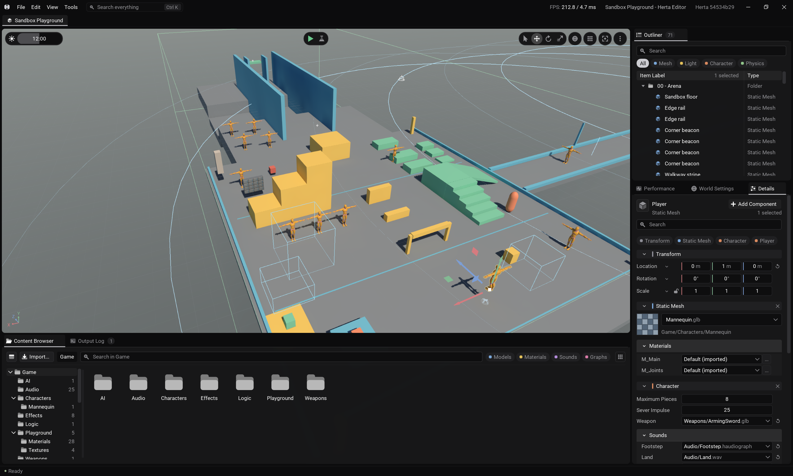

# Herta

A C++23 game engine for Windows and Linux, built around Vulkan. Inspired by Unreal Engine, with a modular architecture.

Herta is a learning project in active development, not a production-ready engine. Author levels with undo/redo, editable PBR materials, lights and shadows, sky/atmosphere, volumetric fog, and SMAA. The editor includes asset import, live reimport, deterministic Jolt Physics with destruction, Material Graphs, and Play with an animated first-person or third-person character; the standalone game packages the same session and plays it alone, hosted, or against a dedicated server. Coding agents can drive a running editor over MCP.



## Getting started

To try Herta without building, download an experimental Windows or Linux Shipping artifact from a successful [CI run](https://github.com/Solessfir/Herta/actions/workflows/ci.yml) on `main`. See [running a prebuilt editor](Docs/GettingStarted.md#prebuilt-editor) for requirements and launch paths.

Clone the repository:

```sh
git clone https://github.com/Solessfir/Herta.git
```

Setup initializes submodules and downloads the pinned build tools and Vulkan SDK. A Vulkan-capable GPU and driver are required.

### Windows

Install Git and Visual Studio 2026 or 2022 with **Desktop development with C++**, then run:

```bat
Setup.bat
GenerateProjectFiles.bat
```

Open the generated `Herta.slnx` or `Herta.sln` in Visual Studio or Rider, select **Development | x64**, and build and run **HertaEditor**.

### Linux

Install a C++23 toolchain, X11/Wayland development packages, and OpenSSL development headers. See [Getting started](Docs/GettingStarted.md#linux) for prerequisites.

```sh
./Setup.sh
./GenerateProjectFiles.sh
make --directory=Intermediate/ProjectFiles/gmake --jobs=2 config=development HertaEditor
./Binaries/linux/x86_64/Development/HertaEditor
```

## Documentation

- [Getting started](Docs/GettingStarted.md) - prerequisites, command-line builds, validation, tests, and cleanup.
- [Editor guide](Docs/EditorGuide.md) - controls, selection, simulation, assets, and the Output Log.
- [Sandbox playground](Docs/Playground.md) - feature stations and how to test them.
- [Projects](Docs/Projects.md) - project creation, loading, and C++ module builds.
- [Levels](Docs/Levels.md) - authored documents, world ownership, and legacy migration.
- [Materials](Docs/Materials.md) - PBR assets, texture maps, live editing, and custom shaders.
- [Engine design](Docs/EngineDesign.md) - architecture and roadmap.
- [Game runtime](Docs/Game.md) - HertaGame, editor Play, staging, and packaging.
- [Physics](Docs/Physics.md) and [Animation](Docs/Animation.md) - determinism, collision, destruction, skinned characters, and state machines.
- [Audio](Docs/Audio.md) - the mixer, streaming, Audio Graphs, and level sounds.
- [Particles](Docs/Particles.md) and [World streaming](Docs/WorldStreaming.md) - VFX Graphs, the particle runtime, and streamed level regions.
- [Navigation](Docs/Navigation.md) and [AI](Docs/AI.md) - tiled navmesh with streamed patches and obstacles, the crowd, StateTrees, perception, and agents.
- [Multiplayer](Docs/Multiplayer.md) - dedicated and listen servers, snapshots, prediction, and rollback over GameNetworkingSockets.
- [Editor automation](Docs/Automation.md) - driving a running editor from MCP clients such as coding agents.
- [Distribution](Docs/Distribution.md) - signed zstd content packages, embedded executables, HertaCooker, and data mods.
- [Next milestone](Docs/EngineDesign.md#milestone-14---localization-and-text) - localization and text, while editor automation over MCP keeps growing.
- [Asset pipeline](Docs/AssetPipeline.md) - import, cooking, and asset formats.
- [Rendering](Docs/Rendering.md), [scaling tests](Docs/Scaling.md), and [editor style](Docs/EditorStyle.md) - implementation details.

## License

Licensed under the [MIT License](LICENSE). Third-party dependencies retain their own licenses.
